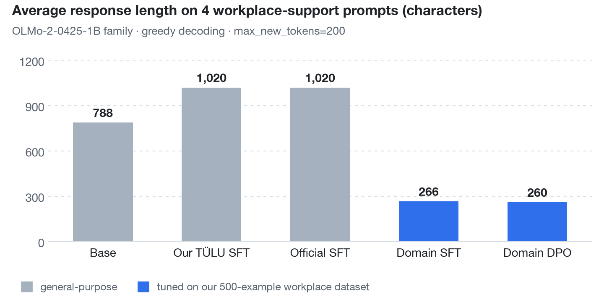

# OLMo Transparency Experiment

**"Transparency enables science"** — an empirical test of the central claim of the OLMo paper



<sub>Average response length (characters) on 4 workplace-support prompts. OLMo-2-0425-1B family, greedy decoding, `max_new_tokens=200`. Length is not a quality metric; it shows a **change in response format**. The Base average includes one empty response and question echoing, and the Our TÜLU SFT average includes `### Instruction:` repetition loops. The two SFT models landing on 1,020 is a coincidence (1020.25 vs 1020.0). Source: [results/olmo2_domain_comparison.csv](results/olmo2_domain_comparison.csv)</sub>

This repo is a small-scale test of the core claim in the OLMo paper from the Allen Institute for AI ([Groeneveld et al., 2024](https://arxiv.org/abs/2402.00838)): releasing the full training data, code, and checkpoints lets outside researchers reproduce and extend a model. Using the openly released OLMo 2 1B weights (Base, SFT, Instruct), we ran four experiments: inspecting intermediate checkpoints, comparing responses across training stages, reproducing SFT with TÜLU data, and extending the model to a new domain, workplace communication for workers with developmental disabilities. All training was done with LoRA on a single RTX 4090.

## Results at a glance

| # | Experiment | Compared | Key result | Source |
|---|---|---|---|---|
| 1 | Public checkpoint inspection | OLMo 2 1B training checkpoints | **268** intermediate checkpoints accessible | [demo.ipynb](notebooks/demo.ipynb) |
| 2 | Response comparison across stages | Base · SFT · Instruct | Empty responses: Base **3/11**, SFT & Instruct **0/11** | [olmo2_english_results.csv](results/olmo2_english_results.csv) |
| 3 | TÜLU-based LoRA SFT reproduction | Our TÜLU SFT vs official SFT | SFT pipeline reproduced by training only **0.0706%** of parameters | [olmo2_sft_comparison.csv](results/olmo2_sft_comparison.csv) |
| 4 | Domain LoRA SFT + DPO | General-purpose vs domain models | Avg. response length **1,020 → 260 chars**, step-by-step guidance format | [olmo2_domain_comparison.csv](results/olmo2_domain_comparison.csv) |

## Quick start

```bash
pip install transformers peft trl==1.7.1 accelerate datasets bitsandbytes huggingface_hub pandas
jupyter notebook notebooks/demo.ipynb
```

The notebook runs Experiments 1 → 4 in order. Training in Experiments 3 and 4 needs an RTX 4090-class GPU; inference for Experiments 1 and 2 runs on smaller GPUs.

| Stage | Model |
|---|---|
| Base | [allenai/OLMo-2-0425-1B](https://huggingface.co/allenai/OLMo-2-0425-1B) |
| SFT | [allenai/OLMo-2-0425-1B-SFT](https://huggingface.co/allenai/OLMo-2-0425-1B-SFT) |
| Instruct | [allenai/OLMo-2-0425-1B-Instruct](https://huggingface.co/allenai/OLMo-2-0425-1B-Instruct) |

## Experiments

### 1. Public checkpoint inspection

Listing the training checkpoints OLMo released turned up **268** intermediate checkpoints. Each name encodes the training stage, step, and cumulative token count.

```text
stage2-ingredient3-step23852-tokens51B
   │        │          │          └─ cumulative training tokens
   │        │          └─ training step
   │        └─ data mix (ingredient)
   └─ training stage
```

Unlike a release of only the final model, this makes it possible to track when a capability emerges, compare before and after a data-mix change, and resume training from any checkpoint.

### 2. Response comparison across training stages

The same 11 English prompts (4 tasks: knowledge QA, commonsense, emotion, summarization) were given to the Base, SFT, and Instruct models.

| Stage | Avg. length | Empty responses | Typical behavior |
|---|---|---|---|
| Base | 425 chars | 3/11 | Fails to respond or repeats the question verbatim |
| SFT | 216 chars | 0/11 | Understands the intent and gives a direct sentence-level answer |
| Instruct | 347 chars | 0/11 | Gives a natural, structured explanation that fits the question |

> **Limitation** — This is not a causal experiment proving that each training stage is the sole cause of the change. It observes response characteristics of the publicly released weights at each stage.

### 3. TÜLU-based SFT reproduction

We applied LoRA SFT to the Base model using a subset of TÜLU, the data used in OLMo's instruction tuning, and compared the result with the official SFT model.

```text
OLMo 2 1B Base  +  TÜLU subset  +  LoRA (0.0706% of all parameters)
                              ↓
                     Our TÜLU SFT model  ⟷  Official OLMo SFT model
```

Compared with Base, question repetition dropped and a basic instruction-following pattern emerged, with direct answers to the instruction. However, some responses still fall into loops repeating template tokens such as `### Response:`, so it falls short of the official SFT model.

> **Limitation** — The goal was not to match the official SFT's benchmark numbers, but to check that the full SFT pipeline can be run externally using only public models and public data.

### 4. Domain extension: LoRA SFT + DPO for workers with developmental disabilities

We built 500 examples of workplace communication training scenarios for workers with developmental disabilities, ran LoRA SFT on them, and then used DPO to steer response preferences.

| Scenario | SFT data fields | DPO target (what `chosen` should do) |
|---|---|---|
| Asking again about a task | Workplace communication situation | Does not label the user's wording as wrong |
| Politely declining a coworker's request | User's answer | Points out what went well first |
| Explaining and apologizing for a mistake | What was expressed well | Uses short, simple sentences |
| Asking for help | What to improve | Does not force a single "correct" phrasing |
| Requesting schedule changes or a break | Alternative phrasings | Offers several alternative phrasings |
| Expressing disagreement gently | Action options | Does not blame or discourage |

As the chart at the top shows, general-purpose models produced long generic answers or repetition (788–1,020 chars on average), while the domain models shifted to roughly 260 chars of step-by-step guidance, e.g. *"First, explain the work task in simple language…"*. Most of the format change came from SFT alone; the difference after DPO was small (266 → 260 chars).

> **Limitation** — Only 4 evaluation prompts were used, and response quality was not measured quantitatively. The results show that response format can be adjusted with a small dataset, nothing more.

## Conclusion

> Because OLMo released its weights, data, and code in full,
> we could inspect intermediate checkpoints, compare Base→SFT→Instruct stages, reproduce TÜLU-based SFT, and extend the model to a new domain.
> None of these experiments would be possible with a model that releases only final weights or is available only through an API.

## Repository structure

```
olmo-open-weights-study/
├── README.md
├── assets/
│   └── domain_response_length.png                # Experiment 4 chart
├── notebooks/
│   └── demo.ipynb                                # Runs Experiments 1–4
├── src/
│   ├── baseline.py
│   └── evaluate.py
├── data/
│   ├── sample_cases.jsonl
│   └── developmental_disability_work_sft_500_en.jsonl   # Experiment 4 domain data (500 examples)
├── results/
│   ├── olmo2_english_results.csv                 # Experiment 2
│   ├── olmo2_sft_comparison.csv                  # Experiment 3
│   └── olmo2_domain_comparison.csv               # Experiment 4
└── docs/
    ├── paper_card.md
    └── project_canvas.md
```

## Environment

| Item | Version |
|---|---|
| Python | 3.11 |
| PyTorch | 2.6+ |
| Key libraries | transformers, peft, trl 1.7.1, accelerate, datasets |
| GPU | RTX 4090 (training in Experiments 3 & 4) / smaller GPUs suffice for inference in Experiments 1 & 2 |

## Application

This work is the foundation for **an LLM service that trains workplace communication skills for workers with developmental disabilities**. The goal is to fine-tune an open-weight model on domain data so it gives situation-specific language feedback and several phrasing options in response to the user's answer.

See [docs/paper_card.md](docs/paper_card.md) and [docs/project_canvas.md](docs/project_canvas.md) for details.
